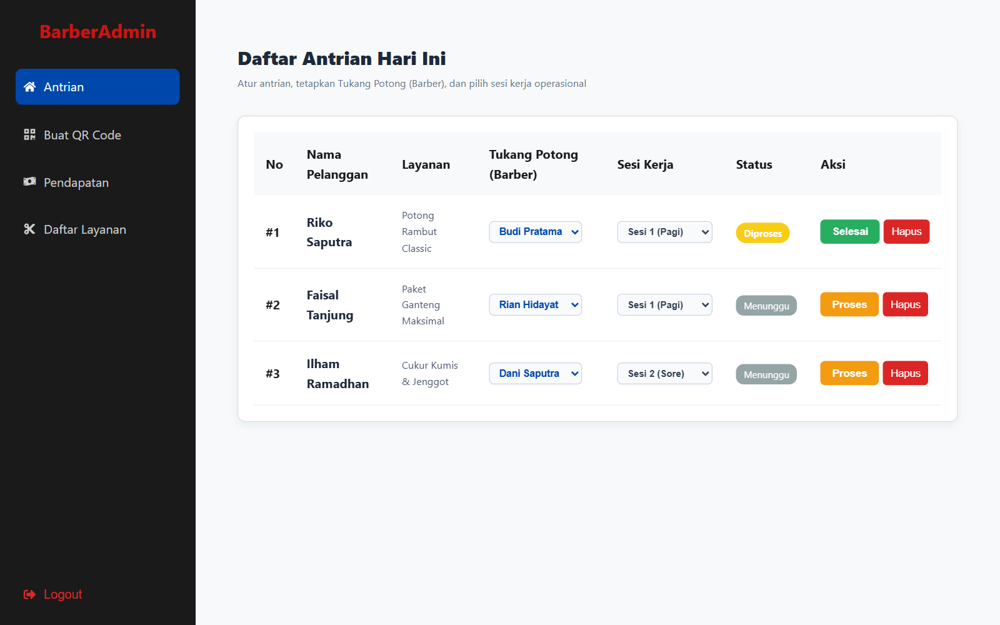
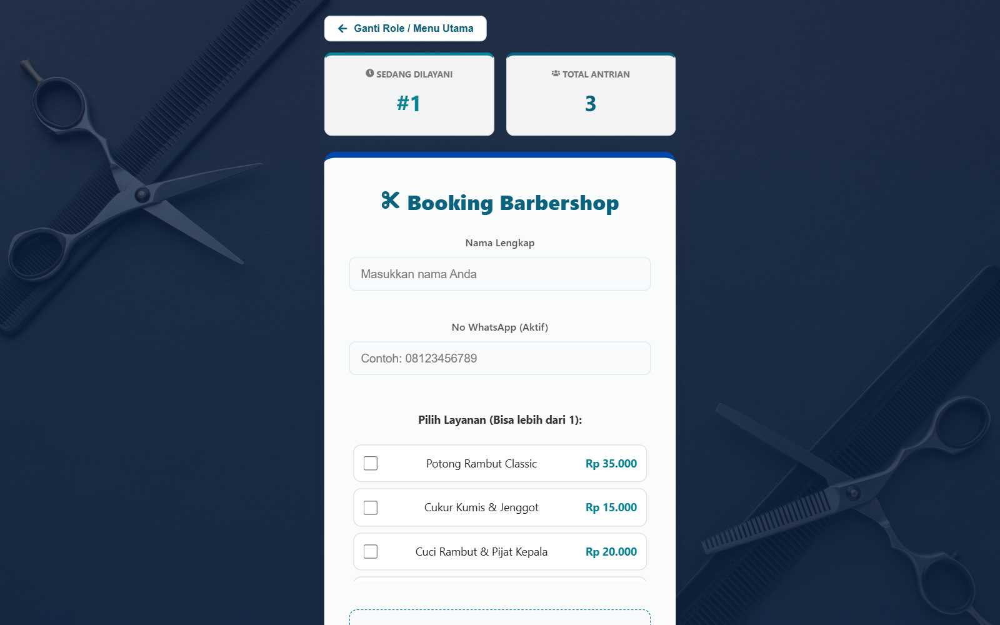
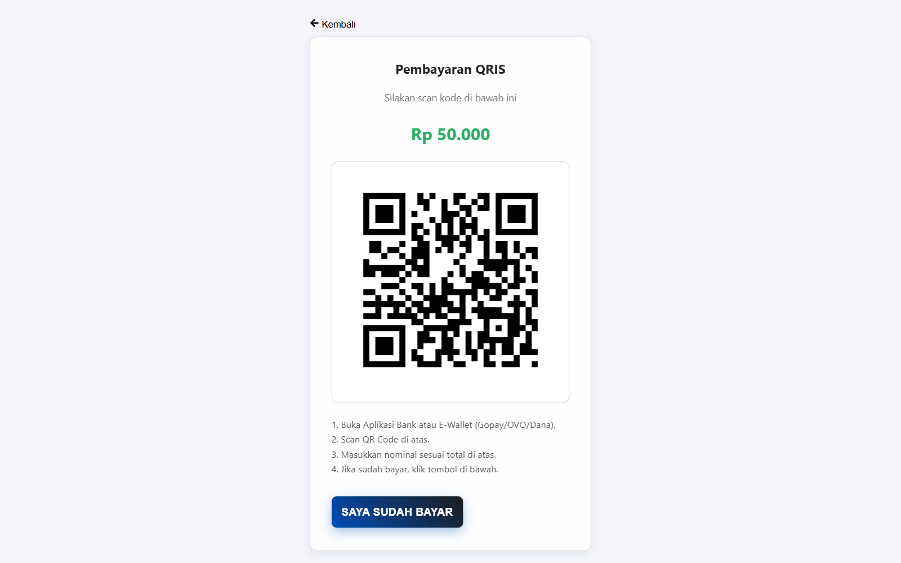
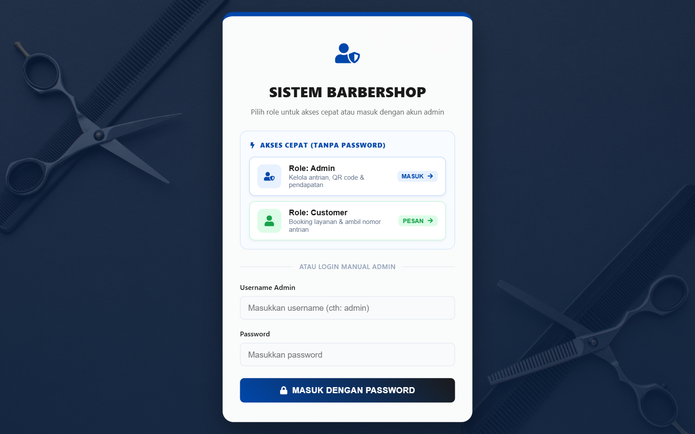
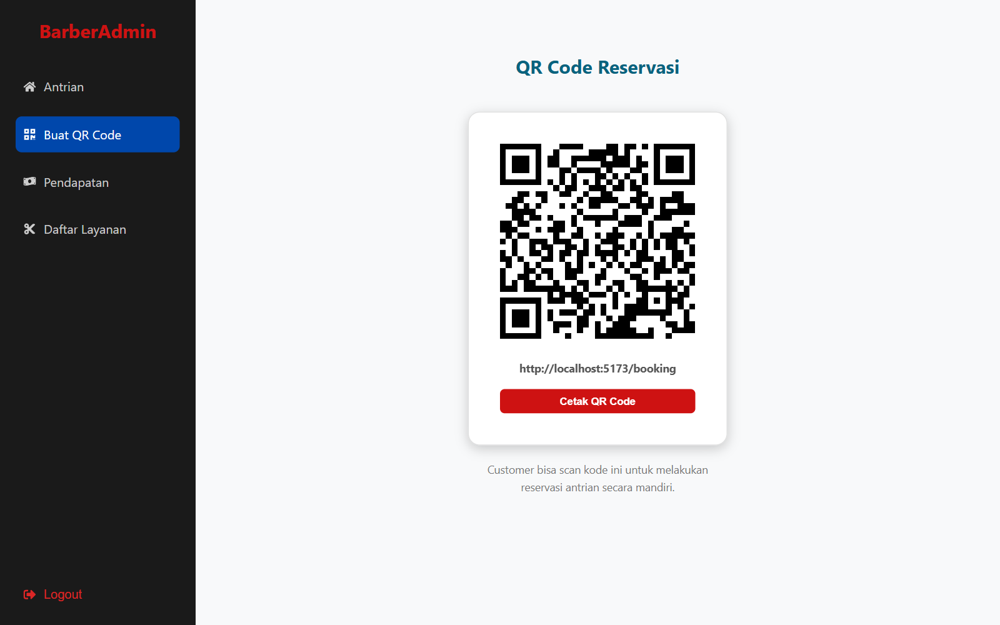
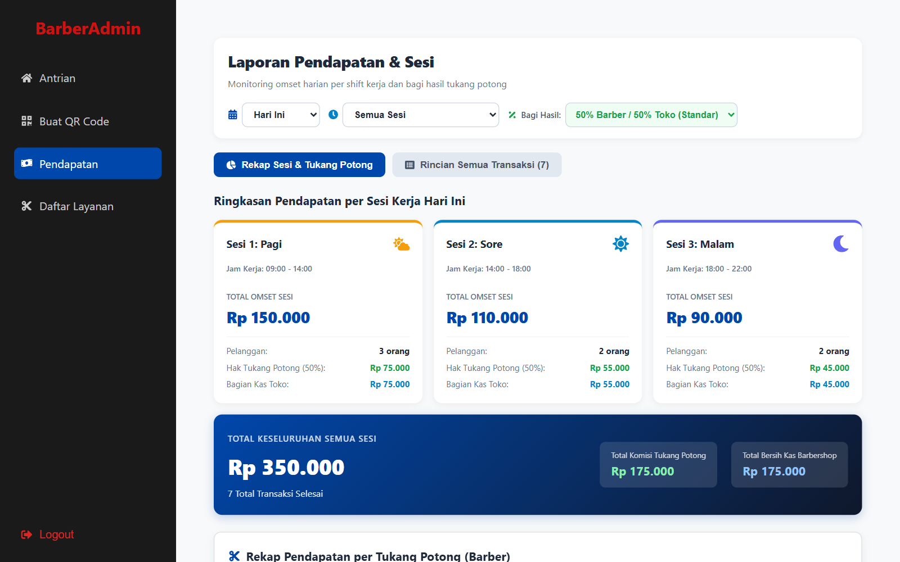
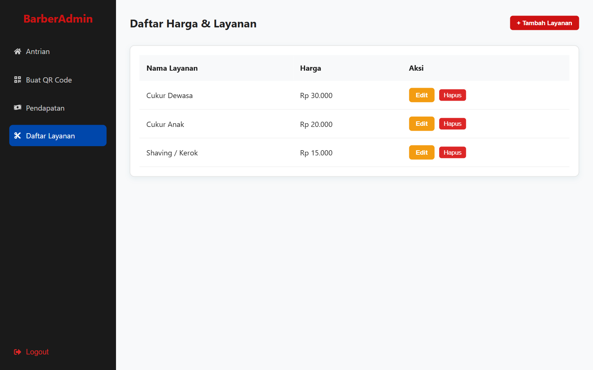
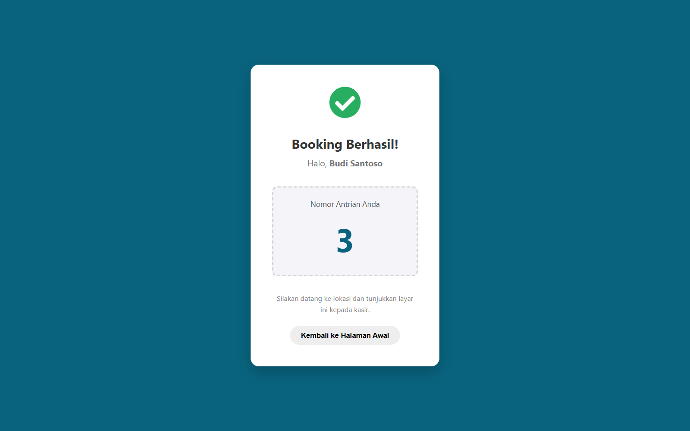

# Sistem Barbershop — Booking & Manajemen Antrian

Aplikasi web fullstack untuk barbershop: pelanggan memesan layanan dan mendapat nomor antrian secara online, sementara admin mengelola antrian harian, tukang potong, sesi kerja, dan rekap pendapatan dari satu dashboard.

## Latar belakang

Antrian barbershop biasanya dicatat manual, sehingga pelanggan harus datang dan menunggu tanpa tahu posisi antriannya. Aplikasi ini memisahkan dua peran dalam satu sistem:

- **Customer** — memilih satu atau beberapa layanan, mengisi nama dan nomor WhatsApp, membayar (simulasi QRIS), lalu menerima nomor antrian. Halaman booking menampilkan nomor yang sedang dilayani dan total antrian secara *live* (polling setiap 5 detik).
- **Admin** — memantau antrian hari ini, mengubah status (`Menunggu` → `Diproses` → `Selesai`), menetapkan tukang potong dan sesi kerja, menghapus antrian, menampilkan QR reservasi, serta melihat pendapatan per hari/minggu/bulan dan per sesi.



| Booking Customer | Pembayaran QRIS |
| --- | --- |
|  |  |

<details>
<summary>Screenshot lainnya</summary>

| Login & pilih role | QR reservasi |
| --- | --- |
|  |  |

| Rekap pendapatan | Daftar layanan |
| --- | --- |
|  |  |

| Booking berhasil |
| --- |
|  |

</details>

> Belum ada *live demo*. Jalankan secara lokal dengan panduan di bawah.

## Fitur utama

- Login admin dengan username/password dari tabel `admins`, plus tombol **Akses Cepat** untuk masuk sebagai Admin atau Customer tanpa password (mode demo).
- Dashboard antrian harian: ubah status, tetapkan barber (`Budi Pratama`, `Rian Hidayat`, `Dani Saputra`), pilih sesi (`Sesi 1 (Pagi)`, `Sesi 2 (Sore)`, `Sesi 3 (Malam)`), dan hapus antrian.
- Booking customer multi-layanan dengan perhitungan total harga otomatis dan validasi minimal satu layanan.
- Nomor antrian dihitung dari jumlah antrian berstatus `Menunggu`, ditampilkan di halaman sukses.
- Status *live* (nomor sedang dilayani dan total antrian hari ini) dengan polling tiap 5 detik.
- Halaman QR reservasi berisi QR code menuju `/booking` (menggunakan `qrcode.react`).
- Rekap pendapatan harian/mingguan/bulanan, filter per sesi, kartu ringkasan sesi, dan tabel pendapatan per barber.
- Data contoh (*mock*) otomatis dipakai bila database belum terhubung, sehingga UI tetap bisa diuji.

## Tech stack

| Bagian | Teknologi |
| --- | --- |
| Frontend | React 19.2, Vite 8 (beta), React Router DOM 7.13, Axios 1.13, react-icons 5.5, qrcode.react 4.2 |
| Backend | Node.js, Express 5.2, `pg` 8.18, `cors` 2.8, `dotenv` 18 |
| Database | PostgreSQL (tipe `SERIAL`, `TIMESTAMPTZ`, `STRING_AGG`) |
| Tooling | npm, concurrently 9.1, ESLint 9 |

## Prasyarat

- **Node.js 20+** dan npm 10+ (dikembangkan dengan Node 26).
- **PostgreSQL 13+** yang berjalan di `localhost:5432`.
- Git.
- Browser modern (Chrome/Edge/Firefox).

## Instalasi

```bash
git clone https://github.com/faridev33/sistem-barbershop.git
cd sistem-barbershop

# Install dependency root, backend, dan frontend sekaligus
npm run install:all
```

### Konfigurasi environment

Salin contoh konfigurasi, lalu sesuaikan kredensial PostgreSQL Anda:

```bash
cp backend/.env.example backend/.env
```

PowerShell:

```powershell
Copy-Item backend/.env.example backend/.env
```

| Variabel | Default | Keterangan |
| --- | --- | --- |
| `PGUSER` | `postgres` | Username PostgreSQL |
| `PGPASSWORD` | `postgres` | Password PostgreSQL |
| `PGHOST` | `localhost` | Host database |
| `PGPORT` | `5432` | Port database |
| `PGDATABASE` | `barbershop_db` | Nama database |
| `PORT` | `5000` | Port HTTP backend Express |

`backend/.env` sudah masuk `.gitignore`; file yang di-commit hanya `.env.example`.

### Setup database

```bash
# 1. Buat database (pilih salah satu)
createdb -U postgres barbershop_db
psql -U postgres -c "CREATE DATABASE barbershop_db;"

# 2. Buat tabel
psql -U postgres -d barbershop_db -f backend/database/schema.sql

# 3. Isi data awal (admin demo + 4 layanan)
psql -U postgres -d barbershop_db -f backend/database/seed.sql
```

Jika `psql` tidak ada di `PATH` (Windows), gunakan path lengkap seperti
`"C:\Program Files\PostgreSQL\16\bin\psql.exe"`, atau jalankan kedua file `.sql` lewat pgAdmin (Query Tool).

### Menjalankan aplikasi

```bash
npm run dev
```

Perintah tersebut menjalankan backend (`node --watch`, port 5000) dan frontend (Vite, port 5173) sekaligus.

- Frontend: <http://localhost:5173>
- API: <http://localhost:5000>
- Health check cepat: <http://localhost:5000/api/booking/services>

Script lain:

| Perintah | Fungsi |
| --- | --- |
| `npm run dev:backend` | Menjalankan backend saja |
| `npm run dev:frontend` | Menjalankan frontend saja |
| `npm run install:all` | Install dependency root + backend + frontend |
| `npm run build --prefix frontend` | Build produksi frontend |

## Akun & alur pengujian

| Peran | Kredensial |
| --- | --- |
| Admin (database) | username `admin`, password `admin123` (dari `seed.sql`) |
| Admin / Customer (demo) | tombol **Akses Cepat** di halaman login, tanpa password |

Alur customer: buka <http://localhost:5173/booking> → isi nama & nomor HP → centang layanan → **Bayar Gunakan QRIS** → **Saya Sudah Bayar** → nomor antrian tampil. Antrian baru kemudian muncul di dashboard admin.

Alur admin: login → **Antrian** → pilih barber/sesi → **Proses** → **Selesai** → cek **Pendapatan**.

> Saat database gagal terhubung, backend memakai data mock dan login menerima `admin` dengan password `admin` atau `admin123`. Hapus fallback ini sebelum dipakai di produksi.

## Halaman

| URL | Akses | Keterangan |
| --- | --- | --- |
| `/` | Publik | Login admin + akses cepat role |
| `/dashboard` | Admin | Daftar antrian hari ini |
| `/dashboard/qrcode` | Admin | QR code menuju halaman booking |
| `/dashboard/pendapatan` | Admin | Rekap pendapatan & sesi |
| `/dashboard/layanan` | Admin | Daftar layanan (state lokal, belum tersimpan ke DB) |
| `/dashboard/layanan/tambah` | Admin | Form tambah layanan (belum tersimpan ke DB) |
| `/booking` | Customer | Form booking & status live |
| `/booking/payment` | Customer | Simulasi pembayaran QRIS |
| `/booking/success` | Customer | Nomor antrian |

## API

| Method | Endpoint | Body / Query | Fungsi |
| --- | --- | --- | --- |
| `POST` | `/api/auth/login` | `{ username, password }` | Login admin |
| `GET` | `/api/booking/services` | — | Daftar layanan |
| `POST` | `/api/booking/create` | `{ nama, no_hp, service_ids: [] }` | Simpan booking & hitung nomor antrian |
| `GET` | `/api/queues/today` | — | Antrian hari ini + layanan & barber |
| `GET` | `/api/queues/status-live` | — | Nomor sedang dilayani & total antrian |
| `GET` | `/api/queues/revenue` | `period=harian\|mingguan\|bulanan`, `session=Sesi 1 (Pagi)` | Rekap pendapatan |
| `PUT` | `/api/queues/:id` | `{ status, barber_name, sesi }` | Ubah status/barber/sesi |
| `DELETE` | `/api/queues/:id` | — | Hapus antrian |

Contoh:

```bash
curl -X POST http://localhost:5000/api/auth/login \
  -H "Content-Type: application/json" \
  -d '{"username":"admin","password":"admin123"}'
```

## Struktur proyek

```text
sistem-barbershop/
├── backend/
│   ├── config/db.js          # Pool PostgreSQL + dotenv
│   ├── controllers/          # auth, booking, queue
│   ├── database/             # schema.sql & seed.sql
│   ├── routes/               # /api/auth, /api/booking, /api/queues
│   ├── .env.example
│   └── index.js
├── frontend/
│   └── src/
│       ├── pages/            # Login, Customer, Dashboard
│       ├── components/       # tabel, kartu, form
│       ├── Layouts/          # layout dashboard
│       └── styles/
├── docs/screenshots/
├── package.json              # script dev & install:all
└── README.md
```

## Batasan & catatan keamanan

Proyek ini adalah aplikasi demo, belum siap produksi:

- Password admin disimpan **plaintext** dan dibandingkan langsung; gunakan `bcrypt`/`argon2` bila dikembangkan.
- Tidak ada middleware autentikasi/JWT; proteksi rute hanya di sisi frontend (`localStorage`).
- `cors()` dibuka untuk semua origin.
- Parameter `session` pada `/api/queues/revenue` disisipkan langsung ke SQL (rawan *SQL injection*); ganti dengan parameter terikat (`$1`).
- Pembayaran QRIS masih simulasi: gambar QR statis dan tombol konfirmasi manual, tanpa payment gateway.
- Halaman **Daftar Layanan** menyimpan perubahan hanya di state React, belum ada endpoint CRUD layanan.
- Backend menambahkan kolom `barber_name`/`sesi` lewat `ALTER TABLE` saat start, dan memakai data *mock* saat database tidak tersedia.
- URL API (`http://localhost:5000`) dan URL QR (`http://localhost:5173/booking`) masih hardcoded; sesuaikan bila mengganti host.

## Lisensi & kontak

Belum ada file `LICENSE` di repositori ini — tambahkan lisensi (mis. MIT) sebelum dipublikasikan sebagai proyek open source.

Dibuat oleh [@faridev33](https://github.com/faridev33). Pertanyaan atau laporan bug: buka [issue](https://github.com/faridev33/sistem-barbershop/issues).